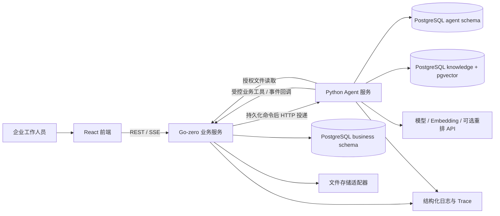
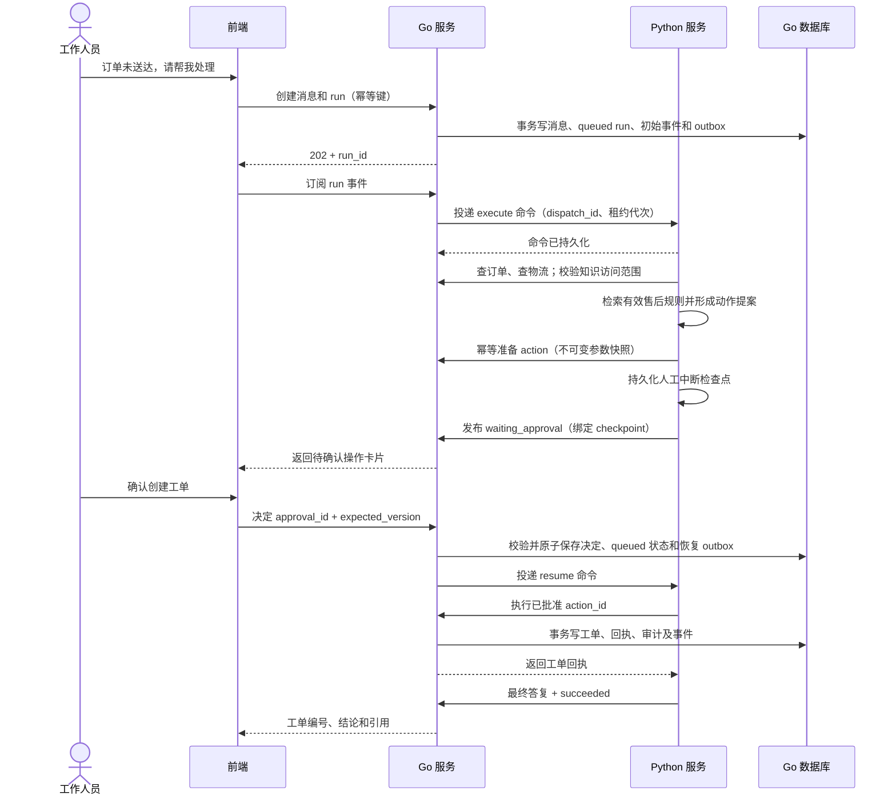

# FlowDesk 总体详细设计

版本：v0.1；日期：2026-11-02；阶段：设计基线，待实现。

## 1. 产品定位与目标

FlowDesk（智办台）是面向企业内部客服及运营的智能工单工作台。核心任务是将“理解问题—查询事实—检索规则—提出方案—人工确认—办理业务—返回凭据”连成一个可恢复、可追踪、可评测的流程。

一期使用合成电商售后数据：订单、订单行、物流轨迹、售后政策和工单。业务服务按本地适配器模拟订单与物流系统，保留未来接入真实 ERP/CRM 的接口。产品用户是企业工作人员，暂不建设面向消费者的门户。

主要目标：

1. 支持自然语言查询订单/物流、检索售后政策、提出工单方案并在确认后执行。
2. 业务事实可追溯到工具结果，政策结论可追溯到具体文档版本和片段。
3. 应对断线、重试、进程重启和并发确认，避免重复写业务数据。
4. 用固定评测任务记录完成率、正确率、耗时和成本，支持比较策略改动。
5. 形成具备后端工程、Agent、RAG、工具调用和评测能力的完整求职作品。

本文所有容量、耗时、成本及质量数字均为设计目标或初始配置，不代表测量结果。

## 2. 一期范围与后续边界

| 能力 | 一期实现 | 后续扩展 |
| --- | --- | --- |
| 身份和权限 | 预置租户、工作人员登录、固定角色、对象级检查 | SSO、自助租户入驻、细粒度自定义角色 |
| 会话与任务 | 多轮消息、单会话串行任务、流式进度、补充信息、取消和恢复 | 跨会话长期记忆、复杂协作 |
| 业务工具 | 查订单、查物流、查工单、创建工单、添加内部备注 | 退款、改地址、外部通知、真实 ERP/CRM |
| 知识库 | 文本型 PDF/Markdown/TXT 上传、版本化、检索、引用 | 扫描件 OCR、网页抓取、复杂表格 |
| 人工确认 | 每次 Agent 业务写操作确认、绑定精确参数、超时和冲突处理 | 金额分级、多人复核 |
| 可观测与评测 | 脱敏执行轨迹、Token/成本统计、离线评测报告 | 完整评测管理 UI、在线实验平台 |
| 工具协议 | HTTP/JSON 适配层、稳定工具名与 JSON Schema | 同业务实现的 MCP 适配入口 |

一期采用单 Agent + 显式状态图。业务是否允许由确定性 Go 逻辑判断，模型负责语言理解、可选步骤和工具选择。流程扩展需要能通过评测证明收益。

## 3. 服务架构



### 3.1 Go 业务服务

- 唯一浏览器 API 入口；负责认证、租户/对象授权和会话访问。
- 拥有订单、物流、工单、知识库元数据、审批、公开任务状态、事件和审计。
- 持久化待调度任务/命令，执行投递、租约续期校验和恢复决策。
- 对 Python 提供受控工具，统一实现业务规则、幂等和事务。
- 从数据库事件流输出 SSE，浏览器重连与 Python 长任务解耦。

### 3.2 Python Agent 服务

- FastAPI 接收内部命令；命令持久化后返回接收结果。
- LangGraph 执行任务，使用持久化 checkpointer，保留明确的 action_id。
- 通过 Go 工具 API 查询或变更业务，通过 Go 回调发布可见状态和事件。
- 处理文档解析、分块、向量化与检索；保存 Python 专属索引和图状态。
- 统一模型适配、上下文预算、工具参数校验、重试和效果评测。

### 3.3 前端

提供会话办理、订单工单查询、人工确认、知识库维护和执行记录。确认卡片使用 Go 返回的结构化操作快照，支持键盘访问、处理中状态和冲突恢复。

### 3.4 存储与所有权

一期复用一个 PostgreSQL 实例，划分 `business`、`agent`、`knowledge` schema 和数据库角色。Go 访问 business，Python 访问 agent/knowledge；数据库迁移账号与运行账号分离。跨服务引用通过 API 和稳定 UUID，不使用跨所有者的数据库写入或外键。

本地文件由 Go 受控存储适配器持有，生产可切换对象存储。Python 持授权凭据读取已登记文件，调用方无法提交任意文件路径。

## 4. 仓库与开发组织

```text
flow-desk/
  AGENTS.md
  README.md
  docs/                         # 总体、协议、数据、质量
  flow-desk-web/                 # React / TypeScript
    src/app/
    src/features/
    src/shared/
    public/
    docs/design.md
  flow-desk-serv/
    AGENTS.md
    flowdesk/                   # 后续 Go module 根
      api/
      flowdesk.api              # 已由 goctl 生成，当前为演示 API
      flowdesk.go               # 已生成入口
      go.mod / go.sum
      internal/{handler,logic,svc,config,middleware,client,worker,types}/
      db/{migrations,model}/
      etc/
      docs/design.md
  flow-desk-agent/
    src/flowdesk_agent/
      {api,graph,tools,retrieval,storage,observability}/
    tests/
    evals/{datasets,reports}/
    docs/design.md
  shared/contracts/
  deploy/
```

服务独立管理依赖、运行时和镜像；根目录保存共同设计。Go 已在 `flow-desk-serv/` 通过 `goctl api new flowdesk` 生成入口和默认分层代码，基线为 Go 1.27.1/goctl 1.10.2/go-zero 1.10.3。前端、Python 工程及业务契约生成器由 M1 继续实现。数据库按用户决定使用 PostgreSQL。

## 5. 身份、租户和权限

一期预置 `operator`、`supervisor`、`admin` 三种工作人员角色，角色权限由 Go 的命名权限集合管理，不需要引入独立权限服务。

| 能力 | operator | supervisor | admin |
| --- | --- | --- | --- |
| 访问自己的会话、运行任务 | 是 | 是 | 是 |
| 查询本租户订单/工单 | 是 | 是 | 是 |
| 创建工单、添加内部备注 | 是 | 是 | 是 |
| 确认自己发起的普通业务操作 | 是 | 是 | 是 |
| 查看团队工单、分配负责人、变更工单状态 | 否 | 是 | 是 |
| 维护知识库和文档版本 | 否 | 否 | 是 |
| 查看租户审计记录 | 否 | 是（脱敏） | 是 |

一期人工确认是操作人确认精确动作，不声称实现了双人复核。后续退款等敏感业务需另行设计职责分离。admin 只在所属租户内生效，不因角色绕过租户和对象校验。成员和固定角色一期通过受控种子/维护命令管理，模型 profile 通过版本化服务配置管理，管理 UI 留待后续扩展。

所有数据库查询与工具调用的 tenant_id 来自可信认证上下文。会话权限检查还包括 owner_user_id；团队工单权限不自动赋予读取他人会话的权利。模型输入的 tenant_id、actor_user_id、权限或批准标记不构成授权。

浏览器使用短期 access token 与 HttpOnly refresh cookie。Go 向 Python 提供按 run、attempt 和 tools scope 限定的短期能力凭据，续期时重新验证任务和用户权限。具体协议见 [接口契约](contracts.md)。

## 6. 用户流程

### 6.1 查询并创建工单



Go 接受创建请求后不在 HTTP 请求内等待完整模型执行。事件持久化是公开状态的依据，浏览器连接断开不取消后台任务。

### 6.2 信息不足

订单号缺失或同一描述匹配多个订单时，Agent 产生结构化问题，保存 checkpoint 并进入 `waiting_input`。前端通过 input 接口补充信息；Go 校验待回答 input_id、预期 run version 和权限，原子写入消息及恢复命令。同一问题重复回答返回已有结果，不创建平行任务。

### 6.3 用户拒绝或修改操作

拒绝决定使当前 action 成为 `rejected` 并终止该 run 为 `cancelled`，保留已有查询记录。修改内容作为下一条用户消息产生新 run，重新生成 action 和确认，原确认不能授权新参数。

### 6.4 知识库更新

管理员创建文档版本并上传文件，Go 持久化索引任务，通过 outbox 投递 Python。Python 校验文件、解析、分块、嵌入并提交新索引 manifest，回调 Go。Go 校验任务、版本和激活序号后原子切换 active_version_id；所有检索命中仍须通过 Go 当前授权/有效性校验。解析失败保留旧有效版本。

### 6.5 工单后续处理

工作人员可手工查询、分配及变更工单状态；这些明确的表单操作走普通业务 API。Agent 发起的创建/备注操作经过 action 确认。两条入口复用 Go 业务校验和表模型，记录不同来源及操作者。

## 7. 状态机

### 7.1 Run 状态

| 状态 | 含义 | 合法后继 |
| --- | --- | --- |
| queued | 已持久化，等待投递/恢复 | running、cancelled、expired、failed |
| running | 受租约保护，执行图节点 | waiting_input、waiting_approval、succeeded、failed、cancelling、queued（确认失联后的恢复） |
| waiting_input | 已持久化问题与检查点 | queued、cancelled、expired |
| waiting_approval | 已持久化动作与确认检查点 | queued、cancelled、expired |
| cancelling | 禁止接受新业务动作，等待执行器停止 | cancelled、failed |
| succeeded | 已保存最终结果 | 无 |
| failed | 已保存失败分类与可见说明 | 无 |
| cancelled | 用户取消或拒绝 | 无 |
| expired | 等待或任务期限已过 | 无 |

终态不可恢复为 running。用户重试失败任务创建新 run，并通过 retry_of_run_id 关联旧任务；旧动作回执继续有效，禁止为了“重试”重复已完成业务。

Go 是状态转移唯一写入者。Python 回调使用 `run_id + lease_generation + source_event_id`，携带检查点引用和请求的状态转移，Go 通过条件更新验证。页面上的节点进度不是另一套 run 状态。

一个会话同一时刻至多有一个非终态 run，等待输入和确认也占位。通过数据库部分唯一约束执行，前端禁用输入只是交互辅助。需要另开任务时新建会话，或先终止原 run。

### 7.2 人工确认动作状态

`prepared → pending → approved → executed`；另有 `rejected`、`expired`、`invalidated` 终结分支。

- prepared：Go 已保存不可变提案，Python 尚未确认可恢复中断已落盘。
- pending：中断检查点落盘且 Go 收到对应事件，可以展示/决定。
- approved：保存工作人员的确认，但实际执行仍需校验当前资源和权限。
- executed：业务写入和回执同一事务提交；重复执行返回同一回执。
- 资源版本、有效政策或权限变化导致 invalidated，需要新动作及新确认。

动作参数使用规范化 JSON 的 SHA-256 摘要，包含 tool_version、业务对象 ID/版本、参数、政策依据版本。批准记录绑定该摘要和 action_id，不接受由前端或模型覆盖参数。

### 7.3 工单状态

一期使用 `open → in_progress → resolved → closed`；允许 `in_progress → open` 和 `resolved → in_progress`。每次变更要求 expected_version 和服务端角色校验。closed 后再次投诉创建关联工单，保留原处理历史。工单创建成功即可完成本次办理 run，无需等待工单被人工解决。

## 8. 调度、恢复与一致性

### 8.1 队列与投递

Go 在创建 run 的同一 PostgreSQL 事务中写 outbox。调度器使用 `FOR UPDATE SKIP LOCKED` 认领到期工作，提交事务后调用 Python。Python 将命令持久化并去重后返回 202；网络结果不确定时重复投递相同 dispatch_id。

一期不依赖额外消息中间件；队列处理为至少一次交付。业务动作依赖稳定 action_id 的幂等回执实现一次业务效果。普通读工具可以重试，写工具只以同一 action_id 查询或重放。

### 8.2 租约与执行隔离

每次新执行代次递增 lease_generation；重复投递同一代次不递增。Go 校验回调、心跳和工具凭据上的代次，拒绝旧执行器的新动作。初始心跳间隔 10 秒、租约 45 秒，参数由配置调整。

Python 每个 run 使用稳定 graph thread ID 和数据库执行锁，至多一个执行器写该图检查点。新代次先要求旧执行器退出，再取得执行锁并恢复；不得仅因 Go 租约到期就并行重放图。检查点保存适配器需校验当前执行所有权。失去锁或数据库连接时停止该执行器，禁止继续保存检查点或调用工具。

一期先支持单 Python worker 进程执行域，持久化锁保留扩展边界。多副本上线前必须通过租约失效、旧 worker 存活、锁连接中断和检查点并发写测试。未能确认安全停止的任务进入人工诊断/failed，不强行启动第二个写执行器。

### 8.3 回调和事件

Python 将待回调事件写自身持久化 outbox；Go 按 source_event_id 去重并分配单 run 单调 seq，事务提交后才确认。Python 收到确认后标记已交付。重复事件摘要不同时返回冲突并报警。

消息增量按短时间窗口合并，避免每个 token 触发数据库事务。最终答复作为权威消息持久化；SSE 事件承载可回放的进度和文本片段。工具成功与 Go 业务回执是事实依据，不以模型声称“已完成”决定状态。

### 8.4 取消及竞争

取消与业务执行先锁定同一 run 行，再锁 action/approval，再写业务表。若取消先提交，后续动作被拒；若业务写入先提交，取消只停止后续步骤，页面必须展示已经发生的业务回执。取消不会撤销已提交的工单或备注。

waiting/queued 任务可以原子变为 cancelled；running 先进入 cancelling，再通过取消命令和合作式检查停止。取消超时后记录 failed 与明确原因，不能伪称执行器已停止。即使旧执行器存活，Go 仍拒绝其新业务动作。

## 9. 检索、上下文与事实依据

- 文档按版本索引，分块保留 document_id、version_id、chunk_id、页码/标题路径。
- 初始分块目标为 600 tokens、重叠 100 tokens；上线参数以评测调整。
- 先按 Go 授权的 tenant/knowledge_base/active version 范围过滤，再进行向量检索与词项匹配融合；中文词项分词由 Python 索引阶段产生。
- 起始召回量 20，重排后取 5；首版可用确定性 RRF 融合基线，重排模型作为可测的扩展。
- 检索返回后向 Go 校验文档当前有效性和访问权限；检查失败丢弃结果。文档撤回和权限撤销立即由 Go 拦截，不依赖异步向量清理。
- 没有足够证据时说明缺失并请求信息或建议人工处理。模型不推测订单事实、政策条款或工具执行结果。
- 对话历史、任务摘要、最新用户输入、工具结果和检索片段采用明确预算和角色边界；历史摘要不能替代原始业务回执。
- 本期持久化会话历史和 run 检查点；用户偏好等跨会话记忆后续再加入。

## 10. 配置、部署与运行

开发环境由前端、Go、Python 和 PostgreSQL/pgvector 组成；代理让浏览器使用统一 `/api/v1`。Python、数据库、指标端口仅在可信网络暴露。生产入口使用 TLS，所有服务间凭据都有用途和期限，开发环境的简化不能绕过业务授权。

配置按服务分组：数据库、模型地址与凭据、向量模型版本、工具 allowlist、租约、重试、限流、任务预算、文件限制和保留期限。示例只列环境变量名，真实密钥由本地环境或密钥管理注入。

健康检查区分进程存活与可接收任务。readiness 检查数据库、必要迁移/索引兼容性；模型供应商短时失败使用降级和明确错误，不让 liveness 反复重启服务。

部署过程与失败恢复见 [部署规划](../deploy/README.md)，指标和阶段验收见 [质量与交付](quality-and-roadmap.md)。

## 11. 关键设计决策

| 决策 | 原因 | 代价及验证 |
| --- | --- | --- |
| Go 业务 + Python Agent | 明确业务事务/授权与模型编排边界 | 增加内部协议，需契约和故障注入测试 |
| PostgreSQL outbox 调度 | 本地易启动，任务和业务状态能原子提交 | 需控制轮询、索引与归档；规模变化后压测再演进 |
| Go 输出持久化 SSE | 重连、鉴权和运行状态统一 | 增加事件写入量，文本增量需合并 |
| 每个 run 独立 graph thread | 减少同会话并发检查点冲突 | 会话历史需要显式组装 |
| 业务动作保存不可变快照 | 重试与确认绑定同一实际动作 | 资源变化需要重新确认 |
| 一期固定角色 | 降低权限配置复杂度，保留授权边界 | 自定义角色后续迁移 |
| HTTP 工具先行、MCP 后续适配 | 优先验证业务办理与授权 | MCP 阶段须另补协议协商和标准授权，不能把普通 HTTP 冒称 MCP |

## 12. 参考来源与适配说明

- 本地参考：`C:/work/go/src/rwa/rwa-tokenization-serv/AGENTS.md`、API 导入布局及权限设计。继承 API-first、表模型 SQL、业务事务、goose 和生成代码纪律，移除钱包、链上、子模块等专属规则。
- [go-zero 项目结构](https://go-zero.dev/concepts/project-structure/) 与 [goctl API 命令](https://go-zero.dev/reference/cli-guide/api/)：用于分层和生成流程；当前脚手架由 goctl 1.10.2 生成，依赖 go-zero 1.10.3。
- [LangGraph 持久化](https://docs.langchain.com/oss/python/langgraph/persistence) 与 [中断恢复](https://docs.langchain.com/oss/python/langgraph/interrupts)：检查点、thread_id 与恢复节点重执行语义。本文的业务幂等和审批账本是 FlowDesk 的补充设计。
- [MCP 授权规范](https://modelcontextprotocol.io/specification/2026-07-28/basic/authorization)：供后续 MCP HTTP 接入参考；一期内部能力令牌不声称是 MCP OAuth 实现。

官方资料于 2026-11-02 查阅。框架能力与业务层约束分开验证，任何升级都需回归检查点兼容、工具行为和接口生成。
