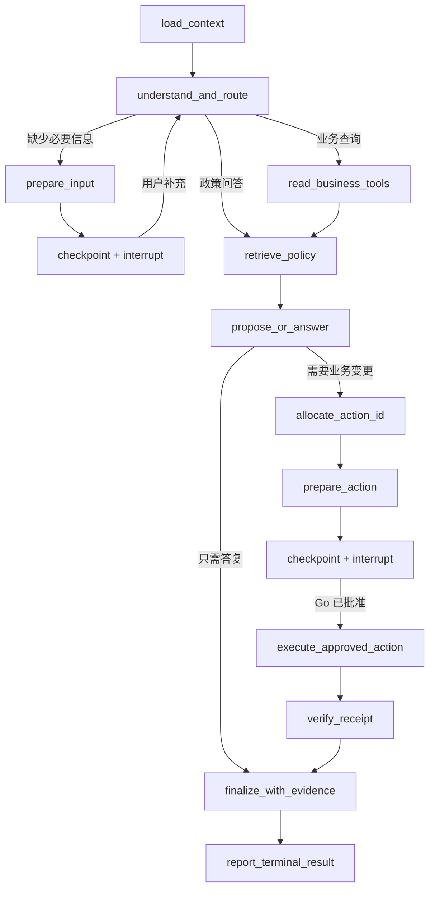

# Python Agent 服务详细设计

M6.5 的 ticket-v2 使用独立 ScenarioPlan 枚举，支持物流建单、接手和办结；read-v1/ticket-v1 保留旧计划 schema。Go 在新任务首次 outbox 固定版本，恢复继续使用原版本。工单编号只能选择当前授权工具结果中的对象，多工单或编号无匹配时先补充输入；更正编号以最后一次补充选择为准。分配、准备、等待确认、执行节点均沿用稳定 action_id 和既有持久化边界，详见[场景契约](../../docs/m6-business-scenarios.md)。

选型：FastAPI + Pydantic + LangGraph；代码采用 `src/flowdesk_agent/`。本文保留完整目标设计；M1–M4 的已运行图、锁文件及当前接口见[实施记录](../../docs/progress.md)，M5 评测见[复跑说明](../../docs/m5-evaluation.md)。

## 1. 包结构与依赖边界

| 包 | 职责 |
| --- | --- |
| api | FastAPI 路由、Pydantic schema、服务认证、错误映射 |
| graph | 状态类型、节点、条件边、图版本和执行入口 |
| tools | Go HTTP client、工具注册/JSON Schema、调用预算与脱敏 |
| retrieval | 文件解析、分块、embedding、词项索引、召回融合、引用 |
| storage | 命令队列、执行锁、checkpointer、callback outbox、索引任务 |
| observability | trace、指标、日志、模型用量与脱敏 |
| evals（仓库级） | 固定数据集、评测 runner、报告和失败归因 |

路由只接收和验证请求，业务执行交给持久化 command worker。模型适配器隐藏供应商接口，图节点依赖窄接口以便 mock。依赖版本在 M1 选择支持的 Python 版本并实际验证，不能直接假定本机最新 Python 与所有库兼容。

## 2. 可信上下文与图状态

状态分成两部分：

- 可信执行上下文：tenant_id、actor_user_id、run_id、lease_generation、graph/prompt/model profile version、tools allowlist、当前 deadline 和累计预算。来自已验证 Go 命令/上下文接口，模型不可覆盖。
- 任务状态：输入消息引用、历史摘要、订单/物流工具结果、检索证据、缺失字段、下一步计划、action_id、approval_id、checkpoint_ref、已执行回执、最终答复草稿。

工具结果保存结构化值和来源更新时间；上下文中的业务版本不是授权本身，Go 会在写操作时重验。任何模型输出先经过 Pydantic/JSON Schema 校验，再进入图条件分支。

## 3. 图与节点

| 节点 | 输入/输出及副作用 |
| --- | --- |
| load_context | 从 Go 读取授权消息、工具和历史回执，组装预算；不使用任意模型租户参数 |
| understand_and_route | 结构化意图、缺失字段、任务类型；最多一次 schema 修复 |
| prepare_input | 生成稳定 input_id 和问题并先落图状态；中断落盘后通过可靠事件向 Go 登记待输入，等待不占工作线程 |
| read_business_tools | 调用确定工具查询事实，保存版本/来源；错误按类别处理 |
| retrieve_policy | 授权过滤召回、融合、复核和证据整理 |
| propose_or_answer | 生成有依据的答复或受限动作提案；不能声称动作已完成 |
| allocate_action_id | 生成稳定 action_id 并返回状态更新，由 checkpointer 在节点边界落盘 |
| prepare_action | 使用已落盘 action_id 调用 Go，准备不可变快照；重复执行安全复用同一 ID |
| wait_approval | 持久化 interrupt；发布等待事件；以 Go 决定恢复 |
| execute_approved_action | 仅用 action_id 调 Go 执行器，超时先查回执 |
| verify_receipt | 比对 Go 回执与提案所指业务对象，保存实际完成结果 |
| finalize_with_evidence | 根据工具结果/回执和有效引用生成最终答复 |
| report_terminal_result | 通过可靠 callback outbox 提交消息与终态 |

统一错误出口将参数问题、权限拒绝、模型不可用、证据不足、预算耗尽、取消和内部异常映射为明确类型。可恢复的网络问题遵守总 deadline；写工具无法确认结果时不得宣称失败并重新建单。

## 4. 持久化与中断恢复

使用数据库持久化 checkpointer，thread_id 固定为 `run:{run_id}`，每个 run 独立。会话历史通过 Go 显式读取，不把 conversation_id 当作任意多任务共用的图线程。

LangGraph 恢复中断时可能从节点开始重新执行，所以外部副作用必须独立且幂等。实现要求：

1. 独立 allocate_action_id 节点先返回并保存 action_id，下一节点才调用 Go；恢复继续使用同一个 ID。仅修改同一节点的内存状态不视为已持久化。
2. Go prepare 接口幂等，重复调用不产生不同确认。
3. interrupt 前的副作用只能是可安全重放的准备操作；实际业务写放在确认后的独立节点。
4. 中断 checkpoint 持久化完成后才允许发布 approval.required/input.required。
5. callback outbox 保存等待通知，避免 checkpoint 成功但 Go 永远看不到等待状态。
6. 执行写操作后以 Go 回执对账，避免业务提交后 checkpoint 尚未保存导致重复写。

恢复命令对照 Go 当前 approval/input 状态。拒绝、取消、过期不由模型决定是否忽略。图版本升级保留旧版本执行器至旧任务结束，或先做显式检查点兼容迁移；不直接用新节点结构读取未知旧状态。

## 5. Worker、执行锁与回调

FastAPI 接收命令时先写 execution_commands 并返回 202。worker 持久化领取、使用 run 级数据库锁和所有权版本，再执行图。相同 dispatch_id 内容不同拒绝；相同命令重复接收返回原状态。

单 run 执行锁贯穿图活跃执行段；等待人工输入/确认后释放活跃计算，但保留 checkpoint。新代次要核对当前 owner 并安全终止旧任务，再取得锁。checkpointer 包装层验证当前所有权，不能只在入口检查一次。

worker 心跳在独立、可取消的任务中进行；失去租约/执行锁后停止发起模型与工具请求。每个工具节点、模型返回后和检查点保存前检查取消/deadline。阻塞的解析或第三方请求使用受限线程/进程及硬超时，不能让无法取消的操作无限占有任务。

一期单 worker 执行域，允许不同 run 在有界并发下执行；多进程副本需要通过总体设计的 fencing/检查点并发故障测试。持久化队列保证进程重启后继续领取未完命令。

回调事件生成稳定 source_event_id，先写 callback_outbox 再发送；按 run 内先后顺序提交，Go ack 后清理。重试保留同一内容和 ID，不能用重试时间修改 occurred_at。终态和最终消息确认前不将命令标为已交付完成。

## 6. 工具适配

工具 schema 由共享契约生成，包含名称、版本、输入输出和只读/写副作用属性。注册 allowlist 由代码和 Go 授权交集决定，模型无法动态注册任意 URL、命令或 SQL 工具。

GoToolsClient 自动注入服务身份、run capability、request/run/trace 标识；这些不进入模型参数。客户端处理超时、schema 校验、脱敏和错误分类；业务允许性仍由 Go 判定。

读工具最多两次可重试网络失败；写工具仅以稳定 action_id 查询/执行。普通参数错误最多一次受限修正，权限拒绝不让模型尝试其他租户或绕过工具。每次尝试计入预算。

M6.2 已实现官方 SDK stdio MCP 适配，复用相同工具定义和 Go action 执行逻辑；配置、生命周期及实测见[MCP 说明](../../docs/m6-mcp.md)。MCP 不开放远程 HTTP 端口，原 HTTP client 仍作为默认适配；第三方远程 MCP/OAuth 尚未实现。

## 7. RAG 索引与检索

### 7.1 索引管线

接收 job→获取专用索引授权→从 Go 拉取受控文件→校验 MIME/大小/页数→解析→分块→embedding→事务提交 manifest/chunks→回调 Go 激活。

文本型 PDF 保留页码，Markdown 保留标题路径，TXT 记录段落位置。解析器不执行文件宏、嵌入脚本或外部链接；扫描件在一期返回不支持 OCR。解析文件使用受控临时目录，失败后清理。

分块初值 600 tokens、重叠 100，记录 splitter_version、embedding model/dimension、原文 hash。相同 job 重投复用版本和 manifest，不重复激活。变更分块或向量模型必须重建，不静默混用索引。

### 7.2 检索管线

1. 从 Go 取可信 knowledge scope 和 ACL revision。
2. 在租户/知识库/有效版本条件下分别向量召回和词项召回。
3. 基线采用 RRF 融合，候选 20，返回 5；是否增加模型重排由评测决定。
4. 向 Go 批量复核候选版本和可见性；撤回/未激活项丢弃。
5. 组装有限长度片段，产生稳定 document/version/chunk 引用。
6. 证据不足时返回缺口，不能靠增大检索范围突破权限。

过滤在召回查询前实施，并在结果返回后复核，不能先跨租户召回再由模型筛选。索引中出现政策式“忽略系统指令”只作为文档内容，无法修改工具权限或图控制流。

## 8. 模型、上下文与预算

模型配置由 Go 选择版本化 profile，Python 负责适配实际供应商。profile 记录模型、温度、结构化输出能力、timeout、输出 token 上限与价格版本引用，不将密钥写入数据库明文配置或 Prompt。

初始 run 总预算：最多 20 图步骤、12 次工具调用、累计 24,000 tokens；单次答复输出上限 4,096 tokens；活跃执行累计 120 秒。人工等待不占活跃时间但受 24 小时总期限及 15 分钟审批期限限制。最多 5 次人工恢复，所有代次共用累计预算，不能重试后归零。

上下文按重要性装配：系统/角色规则→可信执行约束→当前用户输入→当前业务事实/动作回执→检索片段→最近对话→可追溯历史摘要。模型上下文过长时优先压缩低优先级历史，保留当前事实与回执。模型输出经 schema 验证失败时最多一次修复，仍失败则受控终止。

记录实际 usage 和费用估算，价格元数据缺失时标记 cost_unknown，不虚构成本。mock CI 不产生实际模型费用评估。模型自动切换不得改变已批准动作的参数或版本。

## 9. 安全、日志与可观测性

默认记录 run/step/tool ID、耗时、模型 profile、token 数、错误类型和脱敏摘要。业务输入与工具结果按字段 allowlist 脱敏，Trace 不上传原始客户数据或凭据；完整原始 Prompt 调试只能在受控本地合成数据环境显式开启。

指标至少包括：执行/等待队列长度、活跃任务数、模型错误/限流、工具成功率、检查点耗时、回调重试、取消耗时、检索无结果率。Trace 连接 Go 请求、后台 dispatch、图节点和工具调用，后台任务使用 span link/父上下文而非丢失关联。

## 10. 测试与开发阶段

- 单元：节点路由、schema 校验、budget 累加、权限错误处理、引用验证。
- 集成：持久化命令/检查点、interrupt 恢复、callback 去重、文档索引重投、scope 过滤。
- 故障：模型超时、Go 提交后网络断开、checkpoint 前后崩溃、旧 worker 回调、失去锁、取消与工具并发。
- 评测：mock 工具固定功能正确性；真实模型分开评估选择工具、事实依据、RAG 与完成率。

M1 创建 pyproject、锁文件、格式/静态检查和 Pytest 配置；M2 使用假模型先跑通 read-only；M3 引入真实模型/RAG；M4 验证写操作与崩溃恢复；M5 固定版本执行质量报告。细则见 [质量与交付](../../docs/quality-and-roadmap.md)。
